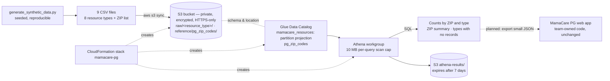

# MamaCare PG — AWS Data-Pipeline Extension

An AWS analytics extension for **MamaCare PG**, a team-built maternal-health resource web app for Prince George's County, Maryland. It stores eight resource datasets in **Amazon S3**, catalogs them with the **AWS Glue Data Catalog**, and queries resource counts by ZIP code with **Amazon Athena**.

> ⚠️ **All resource data here is synthetic.** Names ("Synthetic Food Pantry 07"), street addresses, phone numbers (fictional 555-01xx range), hours and the number of resources per ZIP were generated by one seeded random script. Only the ZIP codes and town names are real. The eight files are **not** eight independent data sources, and query results — including "types with no records" — are **not** evidence of real healthcare access gaps.

**Status:** deployed and verified in AWS (us-east-1) on 2026-11-09. Uploaded files matched local checksums, and all three Athena queries returned results identical, row for row, to the same SQL run locally. The stack is kept running for demos (idle cost is effectively $0).

## Architecture



## What's in this repo

| Path | Purpose |
|---|---|
| `scripts/generate_synthetic_data.py` | Creates the 8 datasets + ZIP reference list (deterministic seed) |
| `sql/01–03_*.sql` | The three analysis queries |
| `scripts/run_local.py` | Runs the same SQL in SQLite to produce expected answers (`data/expected/`) |
| `scripts/compare_results.py` | Checks saved Athena results against the expected answers |
| `infra/template.yaml` | CloudFormation: S3 bucket + policy, Glue database + 2 tables, Athena workgroup |
| `tests/test_pipeline.py` | 9 tests: determinism, synthetic labeling, fictional phones, valid PG ZIPs, schema, query consistency |
| `docs/evidence/athena_results_2026-11-09.json` | Real Athena output with bytes scanned and engine time |

## The eight resource types

Prenatal clinics (22 records), WIC locations (14), Medicaid resources (12), food pantries (30), diaper banks (9), childcare providers (35), transportation assistance (8), mental health services (15) — 145 synthetic records across 27 real PG County ZIP codes. All share one schema: `resource_id, name, street_address, city, state, zip_code, phone, languages, accepts_medicaid, hours, is_synthetic`.

## Verified results (2026-11-09)

| Query | Rows | Data scanned | Athena engine time | Matches local SQL |
|---|---|---|---|---|
| Counts by ZIP and resource type | 93 | 19,941 bytes | 534 ms | ✅ every row |
| ZIP summary (all 27 ZIPs, zero-filled) | 27 | 20,414 bytes | 504 ms | ✅ every row |
| Resource types with no records per ZIP | 27 | 20,414 bytes | 765 ms | ✅ every row |

Example (synthetic): ZIP 20743 (Capitol Heights) has the most records (10); 20774 (Upper Marlboro) has records for only 1 of 8 types. These are artifacts of the random generator, shown only to demonstrate the queries. Times are single runs, not benchmarks.

## Design decisions and trade-offs

| Decision | Why | Trade-off |
|---|---|---|
| **One table partitioned by `resource_type`** instead of 8 tables | One query covers all types; adding a type is a new folder + one enum value | All datasets must share a schema |
| **Partition projection** instead of a Glue crawler | No crawler runs to pay for or wait on; partitions are known instantly | Partition values are listed in the template; a new type needs a template update |
| **CSV** instead of Parquet | Readable, easy to inspect and teach; data is tiny | Athena scans whole files; at real scale Parquet + compression would cut scan cost ~90% |
| **Workgroup with 10 MB scan cutoff, enforced settings** | Hard cap on what any single query can cost; results always encrypted in our bucket | A legitimately large query would be cancelled (raise the cap deliberately) |
| **ZIP reference table + LEFT JOIN** | ZIPs with zero records still appear as 0 instead of silently disappearing | Reference list must be maintained |
| **No DynamoDB** | Athena is for analysis, not page loads (seconds per query, priced per scan). The app's lookups are read-only and small, so exporting the ZIP summary as a static JSON file is cheaper and faster | Data in the app is only as fresh as the last export. DynamoDB becomes worth it if the app needs live updates or user writes |
| **CloudFormation** for every resource | Reproducible, reviewable as a change set, deletable in one step | Data upload is a separate step (`aws s3 sync`) |

## Security considerations

- Bucket: all public access blocked, ACLs disabled, SSE-S3 encryption, bucket policy denies non-HTTPS requests.
- Athena results encrypted and auto-deleted after 7 days; workgroup settings are enforced so clients can't redirect results elsewhere.
- Deployed and operated with a non-root IAM Identity Center role limited to the services used.
- **Limitations:** no Lake Formation fine-grained permissions, no CloudTrail data events, no KMS customer-managed keys. Fine for synthetic public-style directory data; real health or personal data would need all of these plus a data-use agreement.

## Cost

Glue Data Catalog storage is free at this size; S3 holds ~20 KB; Athena bills $5 per TB scanned with a 10 MB minimum per query, so each query here costs about $0.00005. There are no crawlers, clusters or always-on services. Estimates are from list prices, not a bill.

## Deploy, run, tear down

```powershell
pip install pytest
python scripts/generate_synthetic_data.py
python scripts/run_local.py
python -m pytest -v
aws cloudformation deploy --template-file infra/template.yaml --stack-name mamacare-pg --region us-east-1 --profile portfolio
aws s3 sync data s3://mamacare-pg-data-<ACCOUNT_ID>/ --exclude "expected/*" --profile portfolio
```

Then in the Athena console choose workgroup **mamacare-pg-wg**, database **mamacare_pg_synthetic**, and run any file in `sql/`.

Tear down: `aws s3 rm s3://mamacare-pg-data-<ACCOUNT_ID> --recursive --profile portfolio`, then `aws cloudformation delete-stack --stack-name mamacare-pg --profile portfolio`.

## Credits

**MamaCare PG** web application (HTML/CSS/JavaScript) was built by the MamaCare PG team. This repository is **Torhira Aminu's individual extension**: the synthetic datasets, AWS data pipeline, queries, tests and documentation. It does not modify the team's application code. Built with assistance from Claude.
